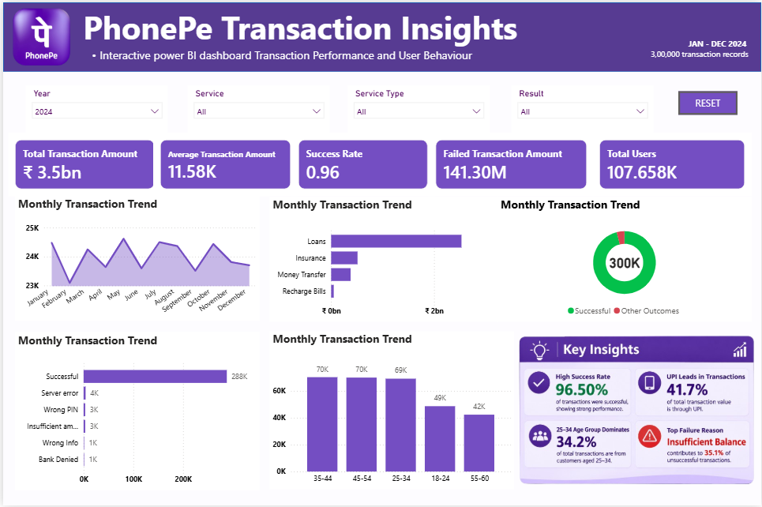

# PhonePe Transaction Insights Dashboard

An interactive **Power BI dashboard** designed to analyze PhonePe
transaction performance and user behaviour across 2024. The dashboard
brings key transaction KPIs, service-level performance, payment
outcomes, failure reasons, and customer demographics into one view.



> **Dataset:** 3,00,000 transaction records\
> **Reporting period:** January--December 2024\
> **Tool:** Microsoft Power BI

## Project Overview

This project explores digital payment transaction data to understand
transaction volume and value, payment success, service usage,
transaction failures, and customer age-group patterns. Interactive
slicers allow users to filter the report and examine performance from
different perspectives.

## Dashboard Highlights

-   **Total Transaction Amount:** ₹3.5bn
-   **Average Transaction Amount:** ₹11.58K
-   **Success Rate:** 0.96 (as displayed in the dashboard)
-   **Failed Transaction Amount:** ₹141.30M
-   **Total Users:** 107.658K

## Key Analysis

1.  **Monthly transaction trend** -- Tracks transaction activity across
    January to December.
2.  **Transaction value by service** -- Compares transaction value
    across services such as Loans, Insurance, Money Transfer, and
    Recharge Bills.
3.  **Payment outcome analysis** -- Shows successful transactions
    against other outcomes.
4.  **Unsuccessful transaction reasons** -- Highlights reasons such as
    server errors, wrong PIN, insufficient amount, wrong information,
    and bank denial.
5.  **Transactions by customer age group** -- Compares activity across
    customer age segments.
6.  **Key insights** -- Summarises success rate, UPI contribution,
    leading age group, and major failure reason.

## Interactive Features

The report includes slicers for: - Year - Service - Service Type -
Result

A **Reset** button is provided to clear the selections and return to the
default report view.

## Tools & Skills

-   Microsoft Power BI
-   Data cleaning and preparation
-   Data modelling
-   DAX measures and KPI calculations
-   Interactive data visualisation
-   Business analysis and insight generation

## How to View the Project

1.  Download the `.pbix` Power BI report file from this repository.
2.  Open it using **Microsoft Power BI Desktop**.
3.  Use the slicers at the top of the report to filter the dashboard.
4.  Select the Reset button to restore the default view.

## Repository Contents

``` text
PhonePe-Transaction-Insights/
│
├── dashboard.png       # Dashboard preview image
├── PhonePe_Insights.pbix  # Power BI report file
├──
└── README.md           # Project documentation

```

## Note

The KPI values and insights shown above are based on the dashboard view
included in this repository. The success rate is displayed as `0.96` in
the report; format it as a percentage in Power BI if the intended
presentation is `96%`.

------------------------------------------------------------------------

**Project:** PhonePe Transaction Insights\
**Category:** Business Intelligence \| Data Analytics \| FinTech
